<table align="center"><tr>
<td width="50%"></td>
<td width="50%">

### 👋 Hey, I'm Rukshan

**Builder from 🇱🇰 Sri Lanka.** I build for any surface: a browser, a phone, a Mac, a microcontroller, or your code editor.

```diff
+ web · mobile · desktop · iot
+ extensions · ai agents · 3d
+ apis · security · games
- "it can't be done"
```


<a href="mailto:rukshantharindu582@gmail.com"></a>

</td></tr></table>

<div align="center">

     
     

</div>

<details><summary><b>📡 Live signal</b> <sub>(auto-updates every 6h)</sub></summary>

<!--LIVE:START-->
```text
  ◉ LIVE · updated 09 Nov 2026 · 05:43 (Colombo)

  🔨 now building ...... passkey-kit
  🏆 most active repo .. passkey-kit
  📝 last commit ....... "Docs, lint, CI and MySQL-tested adapters for the first relea"
  🌡️ mood .............. 🚀 shipping new features
  🕐 local time ........ 05:43 — ☕ booting up with tea

  last 7 days     █     5 commits
  🃏 "I don't always test my code, but when I do, it's in production."
```
<!--LIVE:END-->
</details>

<details><summary><b>🐍 Easter egg</b></summary>
<br/>
<picture>
  <source media="(prefers-color-scheme: dark)" srcset="https://raw.githubusercontent.com/Rukshan2000/Rukshan2000/output/github-snake-dark.svg?v=2" />
  
</picture>
</details>
